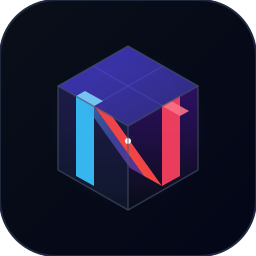

# Neth

**High-Performance Minecraft Server Engine in Rust**

 

---

## Executive Summary

Neth is an advanced, high-concurrency Minecraft server engine developed in Rust. Engineered from first principles to overcome the fundamental scalability bottlenecks of legacy single-threaded architectures, Neth delivers deterministic tick pacing, minimal memory overhead, and native cross-platform networking across Java and Bedrock clients.

The server runtime coordinates world simulation, multi-noise procedural terrain synthesis, dynamic block illumination, and entity behaviors across parallel worker pools while maintaining strict protocol compliance and transactional state integrity.

Neth is maintained by KIYOVN as an open-source initiative, developed as an independent fork of the Pumpkin server project.

---

## Core Engineering Architecture

### Parallel Scheduling and Asynchronous World Pipeline

Workloads across Neth are isolated into distinct asynchronous task queues. World terrain synthesis, noise sampling, and bi-directional lighting calculations execute concurrently on Rayon worker threads. The central tick scheduler operates with sub-millisecond precision, ensuring computational bursts during chunk generation never impede active player network packets or combat tick evaluation.

### Universal Cross-Platform Protocol Pipeline

Neth provides a dual-stack communication interface handling Java Edition protocol streams alongside Bedrock Edition clients via NetherNet WebRTC signaling. Communication channels utilize hardware-accelerated AES-CFB8 encryption, zlib compression, and zero-allocation packet parsing to minimize CPU overhead under heavy player connection density.

### Fault-Tolerant Storage and State Persistence

World persistence adheres to the Anvil region format with multi-layer data safety guarantees. Writes are executed through atomic temporary file swaps, coordinated directory locks (`session.lock`), and automated backup rotation to safeguard chunk palettes, block entity inventories, and player profiles against unexpected hardware interruption.

### WebAssembly Sandboxed Extension Architecture

Custom server extensions execute through an integrated WebAssembly (WASM) host runtime powered by Wasmtime. Extension components communicate via typed WebAssembly Interface Types (WIT), allowing developers to build performant, isolated gameplay extensions in any language compiling to WASM with memory safety and near-native speed.

---

## Licensing and Open-Source Attribution

Neth is free and open-source software licensed under the terms of the GNU General Public License version 3.0 (GPL-3.0).

Portions of this codebase originate from the Pumpkin server project, Copyright 2024-2026 Aleksander Medvedev and Pumpkin contributors, licensed under GPL-3.0. Parity systems, architectural refactorings, multi-platform installers, and ongoing enhancements are Copyright 2026 KIYOVN.
