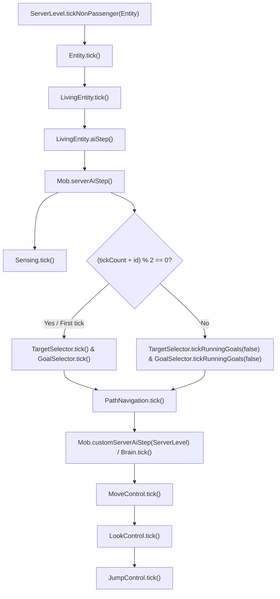

# Vanilla Minecraft 26.3 AI Architecture vs Neth (Rust) Parity Specification

## 1. Overview and Target Version
- **Target Minecraft Version**: 26.3 (Snapshot 26.3, Protocol Version 777, Data Version 5023)
- **Reference Java Source**: Decompiled official vanilla server (`jvmc/src/net/minecraft`) with official Mojang mappings.
- **Rust Implementation**: Neth (`crates/pumpkin-core`) entity AI module (`src/entity/ai/`, `src/entity/mob/`).

---

## 2. Entity Tick & AI Lifecycle Chain

### 2.1. Vanilla Call Hierarchy (`ServerLevel -> Entity -> LivingEntity -> Mob`)

### 2.2. Critical Lifecycle Rules
1. **NoAI Flag (`Mob.isEffectiveAi`)**:
   - If `NoAI` is set, `serverAiStep()` is completely skipped.
   - Passive updates (such as gravity/friction and base living tick) still occur, but AI sensing, goal evaluation, navigation, brain and controls are paused.
2. **GoalSelector Tick Decoupling**:
   - Vanilla evaluates new goals (`canUse()`) and cleans up invalid ones (`canContinueToUse()`) only every **2 ticks** (`(tickCount + id) % 2 == 0 || tickCount <= 1`).
   - On odd ticks, vanilla only calls `tickRunningGoals(false)` which ticks exclusively running goals that have `requiresUpdateEveryTick() == true`.
3. **Controls Execution Order**:
   - Vanilla strictly executes: `moveControl.tick()` -> `lookControl.tick()` -> `jumpControl.tick()`.
   - `JumpControl` applies `mob.setJumping(this.jump)` and clears `this.jump = false` synchronously so that physics in `LivingEntity.travel()` consumes it on the same tick.

---

## 3. GoalSelector & WrappedGoal Architecture

### 3.1. WrappedGoal Representation
- Wraps an underlying `Goal` with an integer `priority` (lower value = higher priority).
- Tracks `isRunning` state.
- Control flags: `EnumSet<Goal.Flag>` (`MOVE`, `LOOK`, `JUMP`, `TARGET`).
- Interruption logic: `canBeReplacedBy(other)` returns `isInterruptable() && other.getPriority() < this.getPriority()`.

### 3.2. GoalSelector Scheduling Algorithm
1. **Cleanup Phase (`goalCleanup`)**:
   - For every running goal in `availableGoals`:
     - If goal uses any currently `disabledFlags` OR `!goal.canContinueToUse()` -> call `goal.stop()`.
   - Purge `lockedFlags` whose entries are no longer running.
2. **Selection Phase (`goalUpdate`)**:
   - For every goal in `availableGoals`:
     - If `!goal.isRunning()` AND does not contain disabled flags AND `goalCanBeReplacedForAllFlags(goal, lockedFlags)` AND `goal.canUse()`:
       - For each flag in goal: stop conflicting running goal and replace with current goal.
       - Call `goal.start()`.
3. **Tick Phase (`goalTick`)**:
   - Call `goal.tick()` for all running goals (if forced/every tick).

---

## 4. Brain & Activity System Architecture

### 4.1. Brain Profile & Provider
- Pre-registers all valid `MemoryModuleType` and `SensorType`.
- Manages memory expirations, activity switching, and core behaviors.

### 4.2. Memory Lifecycle
- `MemoryModuleType<U>`: Holds `Optional<ExpirableValue<U>>`.
- State queries: `VALUE_PRESENT`, `VALUE_ABSENT`, `REGISTERED`.
- Expirations: countdown ticks until value automatically clears.

### 4.3. Activities & Behavior Scheduling
- Core activity runs in parallel with active primary activity (e.g. `CORE` + `IDLE` or `CORE` + `FIGHT`).
- Priority-ordered and weighted behavior gates (`GateBehavior`).

---

## 5. Navigation & Pathfinding Architecture

### 5.1. PathFinder & Node Evaluator
- Node Types: `WALKABLE`, `BLOCKED`, `WATER`, `LAVA`, `DOOR_OPEN`, `DOOR_WOOD_CLOSED`, `DANGER_FIRE`, etc.
- A* algorithm with 3D Manhattan/Euclidean heuristic, min-heap priority queue, target tolerance and max visited node budget.
- Path followers: `GroundPathNavigation`, `FlyingPathNavigation`, `WaterBoundPathNavigation`, `AmphibiousPathNavigation`.
