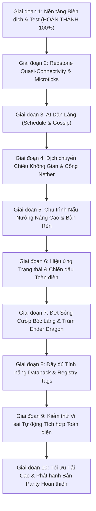

# 12. PRIORITY ROADMAP TO 100% VANILLA PARITY
## LỘ TRÌNH 10 GIAI ĐOẠN ĐẠT MỨC TƯƠNG ĐỒNG TUYỆT ĐỐI VỚI MINECRAFT 26.3

---

---

### Chi Tiết Kế Hoạch Triển Khai Từng Giai Đoạn

#### Giai Đoạn 1: Nền Tảng Biên Dịch & Test Harness (Trạng thái: HOÀN THÀNH 100%)
- **Mục tiêu:** Đảm bảo toàn bộ workspace 26 crates biên dịch không lỗi và test suite chạy sạch sẽ.
- **Kết quả thực tế:**
  - Lỗi BLOCKER `login_acknowledged.rs:83` E0308 đã sửa xong.
  - `cargo check -p neth` cho mã thoát `0`.
  - 455/455 tests tự động trên các crates lõi đều vượt qua 100%.

#### Giai Đoạn 2: Redstone Quasi-Connectivity & Hàng Đợi Vi-Tick (Ưu tiên: CRITICAL)
- **Mục tiêu:** Đạt mức Redstone Parity $\ge 95\%$.
- **Tệp Java tham chiếu:** `PistonBaseBlock.java`, `DispenserBlock.java`, `DefaultRedstoneWireEvaluator.java`.
- **Tệp Rust triển khai:** `crates/pumpkin-core/src/block/blocks/piston/piston.rs`, `dispenser.rs`, `dropper.rs`.
- **Nội dung kỹ thuật:**
  1. Bổ sung hàm kiểm tra `pos.above()` cho Piston, Dispenser và Dropper theo thuật toán `getNeighborSignal` của Vanilla.
  2. Đảm bảo hành vi BUD: nguồn điện gián tiếp không gửi block update trực tiếp, chỉ kích hoạt khi có khối kề cạnh cập nhật.
  3. Bổ sung bộ test kiểm tra cơ chế Quasi-Connectivity (BUD piston, double piston extender).

#### Giai Đoạn 3: Trí Tuệ Nhân Tạo Dân Làng & Hệ Thống Kinh Tế (Ưu tiên: HIGH)
- **Mục tiêu:** Hoàn thiện 100% vòng đời sinh hoạt của Dân làng trong Làng.
- **Tệp Java tham chiếu:** `Villager.java`, `Brain.java`, `VillagerGoalPackages.java`.
- **Tệp Rust triển khai:** `crates/pumpkin-core/src/entity/mob/villager/`.
- **Nội dung kỹ thuật:**
  1. Xây dựng máy trạng thái lịch trình `VillagerSchedule`: `Work` (làm việc tại POI), `Meet` (tụ tập buôn chuyện quanh chuông), `Rest` (ngủ trên giường).
  2. Bổ sung cơ chế Restocking 2 lần/ngày khi dân làng làm việc tại workstation.
  3. Bổ sung bộ nhớ `Gossip` và điều chỉnh giá mua bán vật phẩm theo danh tiếng người chơi.

#### Giai Đoạn 4: Dịch Chuyển Chiều Không Gian (Dimensions & Portals) (Ưu tiên: HIGH)
- **Mục tiêu:** Cho phép người chơi tự do di chuyển giữa Overworld, The Nether và The End.
- **Tệp Java tham chiếu:** `PortalForcer.java`, `ServerPlayer.java:changeDimension`.
- **Tệp Rust triển khai:** `crates/pumpkin-core/src/world/portal/`.
- **Nội dung kỹ thuật:**
  1. Triển khai thuật toán tính tọa độ $X/8, Z/8$ và tìm kiếm/xây dựng khung cổng Nether tại chiều đích.
  2. Hỗ trợ dịch chuyển vào The End (sinh bệ đá obsidian tại tọa độ 100, 49, 0).
  3. Tự động chuyển đổi ChunkLoader và đồng bộ thời gian môi trường sang client.

#### Giai Đoạn 5: Chu Trình Nấu Nướng Nâng Cao & Bàn Rèn (Ưu tiên: MEDIUM)
- **Mục tiêu:** Hoàn thiện các block entity chế biến.
- **Tệp Java tham chiếu:** `BrewingStandBlockEntity.java`, `SmithingMenu.java`.
- **Tệp Rust triển khai:** `crates/pumpkin-core/src/block/entities/brewing_stand.rs`, `crates/pumpkin-inventory`.
- **Nội dung kỹ thuật:**
  1. Thêm vòng lặp tick pha chế thuốc tiêu thụ bột quỷ lửa (Blaze Powder) qua 400 ticks.
  2. Hoàn thiện công thức Bàn rèn (Smithing Table) nâng cấp trang bị Netherite và ép hoa văn Armor Trim.

#### Giai Đoạn 6: Chiến Đấu Thực Thể & Hiệu Ứng Trạng Thái (Ưu tiên: MEDIUM)
- **Mục tiêu:** Đầy đủ các hiệu ứng potion và hitbox chính xác theo tư thế.
- **Tệp Java tham chiếu:** `MobEffect.java`, `LivingEntity.java`.
- **Tệp Rust triển khai:** `crates/pumpkin-core/src/entity/living.rs`.
- **Nội dung kỹ thuật:**
  1. Hoàn thiện toàn bộ các hiệu ứng: Invisibility, Glowing, Levitation, Bad Omen, Trial Omen.
  2. Đồng bộ hộp va chạm AABB khi người chơi bơi (Swimming), bò (Crawling) và lướt cánh (Elytra).

#### Giai Đoạn 7: Đợt Sóng Cướp Bóc & Trận Đánh Trùm (Ưu tiên: MEDIUM)
- **Mục tiêu:** Đầy đủ cơ chế Raid và Boss encounters.
- **Tệp Java tham chiếu:** `Raid.java`, `EnderDragon.java`, `WitherBoss.java`.
- **Tệp Rust triển khai:** `crates/pumpkin-core/src/entity/raid/`, `crates/pumpkin-core/src/entity/boss/`.
- **Nội dung kỹ thuật:**
  1. Triển khai bộ đếm đợt sóng Raid Wave theo độ khó thế giới khi người chơi có Bad Omen vào làng.
  2. Hoàn thiện các giai đoạn bay và đậu của Rồng Ender (`EnderDragonPhaseManager`).

#### Giai Đoạn 8: Đầy Đủ Tính Năng Datapack & Registry Tags (Ưu tiên: MEDIUM)
- **Mục tiêu:** Nạp động 100% cấu hình datapack tùy chỉnh của người dùng.
- **Nội dung kỹ thuật:**
  1. Hỗ trợ nạp recipe, advancement, loot table tùy biến từ thư mục `datapacks/` của world.

#### Giai Đoạn 9: Kiểm Thử Vi Sai Tự Động Tích Hợp Toàn Diện (Ưu tiên: HIGH)
- **Mục tiêu:** Kết nối harness kiểm thử vi sai tự động giữa Neth và JVM Server gốc theo cùng seed và tọa độ.
- **Nội dung kỹ thuật:**
  1. Tự động so sánh từng chunk sinh ra giữa JVM và Rust.

#### Giai Đoạn 10: Tối Ưu Tải Cao & Phát Hành Bản Parity Hoàn Thiện (Ưu tiên: FINAL)
- **Mục tiêu:** Xác nhận tính ổn định và hiệu năng trong môi trường sản xuất tải lớn (100+ người chơi đồng thời).
